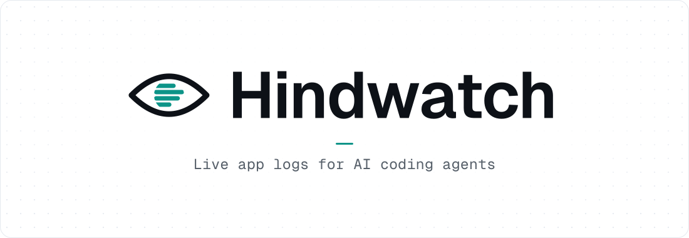
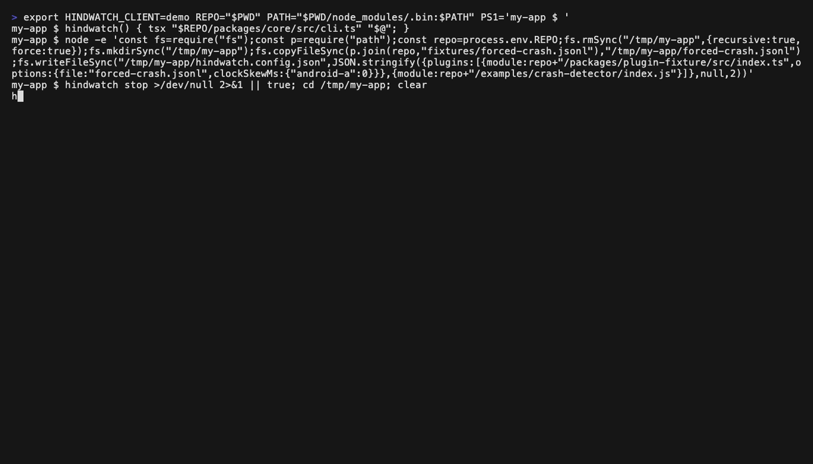
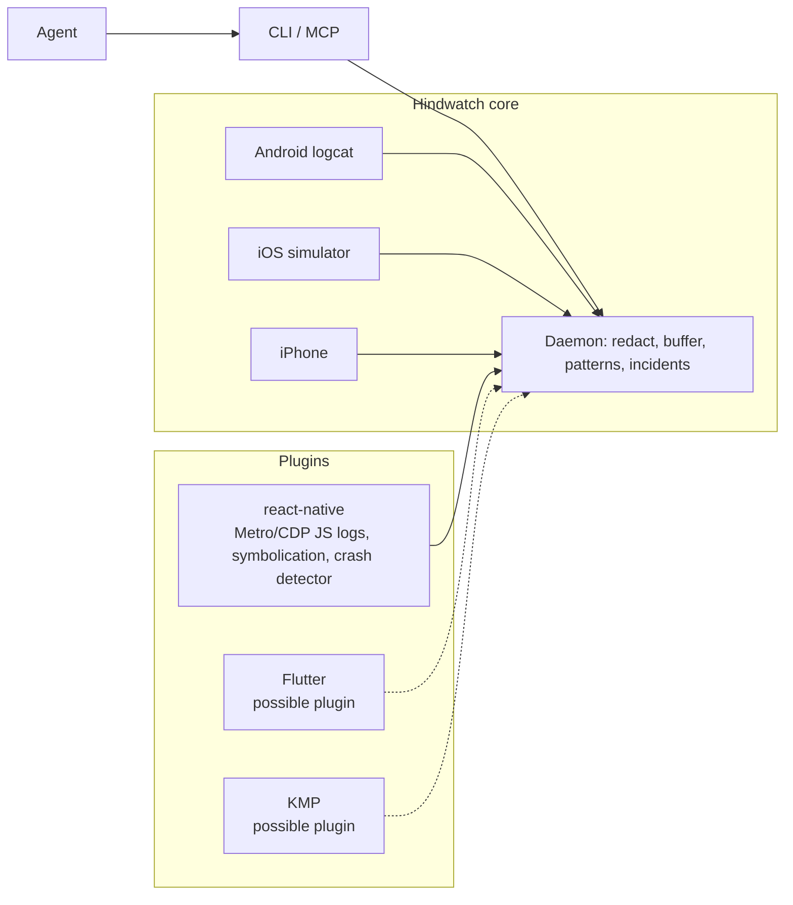

<h1 align="center">
  <picture>
    <source media="(prefers-color-scheme: dark)" srcset="docs/assets/hindwatch-banner-dark.svg">
    
  </picture>
</h1>

<p align="center">
  <strong>A flight recorder for coding agents on a running mobile app.</strong>
  <br>
  Metro JS logs, Android logcat, the iOS simulator and iPhones in one redacted timeline, read over a JSON CLI or MCP.
</p>

<p align="center">
  <a href="https://github.com/omer-ayhan/hindwatch/actions/workflows/ci.yml"></a>
  <a href="https://www.npmjs.com/package/hindwatch"></a>
  <a href="LICENSE"></a>
  <a href="package.json">= 22"></a>
</p>

<p align="center">
  <a href="#quick-start">Quick Start</a> &bull;
  <a href="#how-it-works">How it works</a> &bull;
  <a href="#tools">Tools</a> &bull;
  <a href="#docs">Docs</a>
</p>

<p align="center"></p>

---

## The problem

A coding agent can't see Metro, logcat, simulator or iPhone logs on its own. It can run one command when it thinks to ask, and it gets raw text back.

## What Hindwatch does

One background daemon per project keeps recording, so the agent can ask what happened before the crash and check that a fix worked. It is for React Native and Expo developers who use Claude Code, Cursor or Codex. React Native support comes from a plugin, so Flutter, KMP and other frameworks are possible through a plugin too.

- **Records** - logs from before the agent asked are already in the buffer.
- **Groups** - one call returns the first error, the events from every source that led up to it, and the resolved stack with a `file:line` snippet.
- **Collapses** - repeated lines fold into one template with a count. Known noise can be muted per project.
- **Verifies** - `mark`, `wait-for` and `expect` exit 0 or 1, so the agent can prove a fix worked.
- **Redacts** - always on. Every event is redacted before it reaches the buffer, a plugin, the CLI or MCP.

## Quick Start

**1. Install.** Hindwatch needs Node 22 or newer. The npm package includes the React Native plugin.

```sh
npm install -g hindwatch      # or: pnpm add -g hindwatch / yarn global add hindwatch / bun add -g hindwatch
hindwatch --help
```

To run it once without installing, use `npx hindwatch` (or `pnpm dlx hindwatch`, `bunx hindwatch`).

<details>
<summary>From source</summary>

```sh
git clone https://github.com/omer-ayhan/hindwatch.git
cd hindwatch
npm install
alias hindwatch="node $PWD/packages/hindwatch/dist/core/src/cli.js"
hindwatch --help
```

`npm install` also builds the CLI into `packages/hindwatch/dist/core/src/cli.js`. Put the alias in your shell profile to keep it.

</details>

**2. Start your app, then the daemon.** Run these in the folder of your app. Start the app (and its bundler, if it has one) first. With no config file, Hindwatch reads `package.json`. If it depends on `expo` or `react-native`, it records JS logs from Metro on port 8081.

```sh
hindwatch doctor          # check adb, Xcode tools and Metro; starts nothing
hindwatch start           # start the daemon
```

**3. Mark the moment, then reproduce the bug.**

```sh
hindwatch mark before-tap
```

**4. Read the incident.**

```sh
hindwatch incidents       # list incidents, then open one
hindwatch incident 1
```

**5. Prove the fix.**

```sh
hindwatch expect --absent TypeError --since before-tap   # after the fix: exit 1 if still there
```

**6. Connect your agent.** See [Supported clients](#supported-clients).

<details>
<summary>A real session on the repo's crash fixture</summary>

This session ran on the repo's crash fixture (`fixtures/forced-crash.jsonl`), output pasted as printed:

```console
$ hindwatch mark after-crash --root fixtures/projects/demo
{"mark":{"name":"after-crash","id":304,"ts":1793274819738}}
$ hindwatch incidents --root fixtures/projects/demo
{"schemaVersion":1,"incidents":[{"id":1,"kind":"crash","title":"TypeError: Cannot read property 'name' of undefined","count":2,"source":"react-native","app":"com.hindwatch.fixture","firstTs":1700000115200,"lastTs":1700000115900,"stale":true}],"truncated":false,"omitted":0,"next":null,"lastId":1,"startedAt":1793274818508}
$ hindwatch expect --absent TypeError --since after-crash --root fixtures/projects/demo
{"ok":true,"expect":"absent","matched":0,"window":{"fromId":0,"toId":0},"schemaVersion":1,"order":"asc","events":[],"truncated":false,"omitted":0,"muted":0,"next":null,"lastId":304}
```

</details>

## How it works



The core is framework-agnostic: it records Android logcat, the iOS simulator and iPhones on its own, and raises incidents for Android Java and native crashes, Android ANRs, and iOS crash reports. React Native support comes from a plugin, `@hindwatch/plugin-react-native`, which adds Metro/CDP JS logs, symbolication and the crash detector. Flutter, KMP and other frameworks are possible through a plugin that adds a source, enricher or detector. Only the React Native plugin is built today. See [docs/plugins.md](docs/plugins.md).

## Tools

Every CLI command prints JSON on stdout. Run `hindwatch --help` for the commands and `hindwatch <command> -h` for one command's options. The MCP tools serve the same daemon.

| CLI                                 | MCP tool    | What it does                                                                                |
| ----------------------------------- | ----------- | ------------------------------------------------------------------------------------------- |
| `status`                            | `status`    | The daemon's state, sources, buffer and warnings. The MCP tool starts the daemon if needed. |
| `doctor`                            | `doctor`    | Check that adb, Xcode tools and Metro are there. Starts nothing.                            |
| `logs`                              | `logs`      | Read the timeline. Filter by `--level`, `--source`, `--app`, `--since`, `--until`.          |
| `patterns`                          | `patterns`  | The timeline folded into repeated-line patterns with counts.                                |
| `incidents`                         | `incidents` | Incidents, oldest first.                                                                    |
| `incident <id>`                     | `incident`  | One incident: trigger, stack, code, first error and what led up to it.                      |
| `mark <name>`                       | `mark`      | Mark this point of the timeline, for `--since` and `--until`.                               |
| `marks`                             | `marks`     | List your marks.                                                                            |
| `wait-for [text]`                   | `wait_for`  | Wait for the next matching event. Exits 1 on `--timeout <ms>`.                              |
| `expect --absent\|--present [text]` | `expect`    | Check once queued events land, up to `--timeout <ms>`. Exits 1 if it doesn't hold.          |
| `mute <pattern-id>`                 | `mute`      | Hide a pattern. The rule goes into `mute` in `hindwatch.config.json`.                       |
| `unmute <rule-id>`                  | `unmute`    | Remove a mute rule.                                                                         |
| `noise`                             | `noise`     | List the mute rules.                                                                        |
| `export --out <file>`               | `export`    | Write the window to a file, redacted.                                                       |
| `stop`, `exit`                      | `stop`      | Stop the daemon and drop its buffer. `--force` if other clients are attached.               |

`start` (CLI only) starts the daemon and is safe to repeat. `mcp` serves the tools on stdio.

## Supported clients

| Client          | Setup                             | Status                                                       |
| --------------- | --------------------------------- | ------------------------------------------------------------ |
| **Claude Code** | `.mcp.json` in the project folder | Tried in a live Claude Code launch                           |
| **Cursor**      | `.cursor/mcp.json`                | Follows Cursor's docs, not yet tried in a live Cursor launch |
| **Codex**       | `codex mcp add`                   | Follows the Codex docs, not yet tried in a live Codex launch |

These use `npx`, so no global install is needed. From source, replace `npx -y hindwatch` with `node /path/to/hindwatch/packages/hindwatch/dist/core/src/cli.js`. Without `--root`, the server's working directory picks the project.

<details open>
<summary><strong>Claude Code</strong></summary>

Put this in `.mcp.json` in the project folder:

```json
{
  "mcpServers": {
    "hindwatch": {
      "command": "npx",
      "args": ["-y", "hindwatch", "mcp"]
    }
  }
}
```

Or run this in the project folder:

```sh
claude mcp add hindwatch -- npx -y hindwatch mcp
```

</details>

<details>
<summary><strong>Cursor</strong></summary>

Put this in `.cursor/mcp.json`. `--root` pins the project, since Cursor's docs don't say which working directory the server gets. This follows Cursor's docs but has not yet been tried in a live Cursor launch:

```json
{
  "mcpServers": {
    "hindwatch": {
      "command": "npx",
      "args": ["-y", "hindwatch", "mcp", "--root", "${workspaceFolder}"]
    }
  }
}
```

</details>

<details>
<summary><strong>Codex</strong></summary>

Run this in the project folder. This follows the Codex docs but has not yet been tried in a live Codex launch:

```sh
codex mcp add hindwatch -- npx -y hindwatch mcp
```

</details>

For longer agent playbooks (crash triage, fix verification), copy the opt-in skill in [.claude/skills/hindwatch](.claude/skills/hindwatch/SKILL.md) into your project.

## Measure it

The `wait_for`, `expect`, `mute`, `unmute` and `noise` tools also return a short context: daemon status, open incidents and top patterns, so the agent needs fewer follow-up calls.

| Fix-verify loop     | Calls | Characters |
| ------------------- | ----- | ---------- |
| Without the context | 10    | 3666       |
| With the context    | 7     | 2708       |

Measured on the fixture with `scripts/u4-companion-prove.ts`.

## Docs

<details>
<summary><strong>Logcat, the iOS simulator and iPhones</strong></summary>

Add `hindwatch.config.json` to the project folder to record native logs too:

```json
{
  "sources": {
    "android": { "package": "com.example.app" },
    "ios-sim": { "bundleId": "com.example.app", "minLevel": "info" },
    "ios": { "bundleId": "com.example.app", "minLevel": "info" }
  },
  "plugins": ["@hindwatch/plugin-react-native"],
  "plumbing": ["my-lib/"],
  "logTimeSpan": 1800000
}
```

A config file replaces zero-config, so list the react-native plugin to keep Metro's JS logs. Where Metro lets only one debugger hold an app, Hindwatch steps aside when React Native DevTools takes it, and `status` says so. Metro doesn't tell anyone when DevTools closes, so JS logs resume once the app's page leaves Metro or Metro stops; to resume sooner, close DevTools and stop the daemon. A daemon that starts while DevTools is open takes the app once; reconnect DevTools and Hindwatch steps aside again. `ios-sim.minLevel` and `ios.minLevel` default to `info`; set `debug` or `verbose` when a native bug needs it. Android has no ingest floor. `logTimeSpan` is how many milliseconds of timeline the daemon keeps (default 1800000, 30 minutes); only age evicts events, so a noisy app grows memory instead of shortening the span. `plumbing` adds stack-frame patterns (regex) for your own deps on top of the built-in RN/devtools list.

`ios` records an iPhone attached to the Mac by USB, as Console.app does: through usbmuxd to the device's log stream, signed in with the pairing the Mac made when the iPhone was trusted. It needs no root and no relaunch, and it follows the app across restarts and reinstalls. Crash reports come from the device through `xcrun devicectl` (Xcode 15 or newer). With more than one iPhone attached, set `ios.device` to the UDID that `xcrun devicectl list devices` shows. JS logs from an iPhone come through Metro, as from any device.

</details>

<details>
<summary><strong>Redaction</strong></summary>

Redaction is always on and no config or plugin can turn it off. Every event is redacted before it reaches the buffer, a plugin, the CLI or MCP. It covers private keys, bearer and basic auth, JWTs, AWS keys, emails and `key=value` secrets, and masks sensitive attribute names such as `password` or `token`.

</details>

<details>
<summary><strong>Project root and daemon lifecycle</strong></summary>

The project root is the nearest folder with `hindwatch.config.json` or `package.json`. Pass `--root <dir>` to pick another. `start` refuses a root with nothing to record, and never starts in your home folder or `/` alone.

`doctor` checks Node, the config, the runtime folder, adb, adb devices, `xcrun simctl`, `xcrun devicectl`, the iPhone and Metro. It never starts the adb server or a simulator.

The daemon stops itself after 30 minutes with no client attached and no command. Once stopped, it leaves only its log in `~/.hindwatch/run` (at most 1 MB plus one older copy) and a `.stderr` file, emptied at each start. After a kill -9, the next command cleans up the rest.

</details>

- [Plugins](docs/plugins.md): write a source, enricher or detector.
- [Security](SECURITY.md): known issues.

## Contributing

The repo layout and dev commands are in [AGENTS.md](AGENTS.md). CI runs these, so run them before a PR:

```sh
npm run typecheck
npm test
npm run smoke:pack
```

Commit messages follow [Conventional Commits](https://www.conventionalcommits.org). Each merge to `main` that passes CI is released by [semantic-release](https://github.com/semantic-release/semantic-release): `fix:` publishes a patch, `feat:` a minor and a `!` or `BREAKING CHANGE:` footer a major, with the version tag and GitHub release notes written from those commits.

## License

MIT, see [LICENSE](LICENSE).
